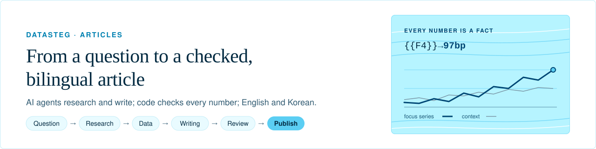
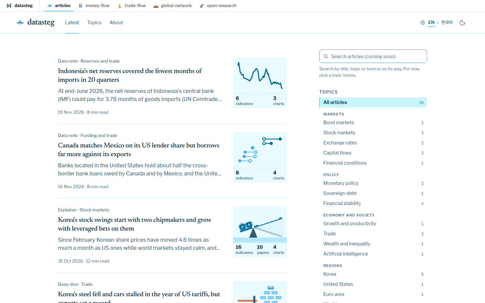
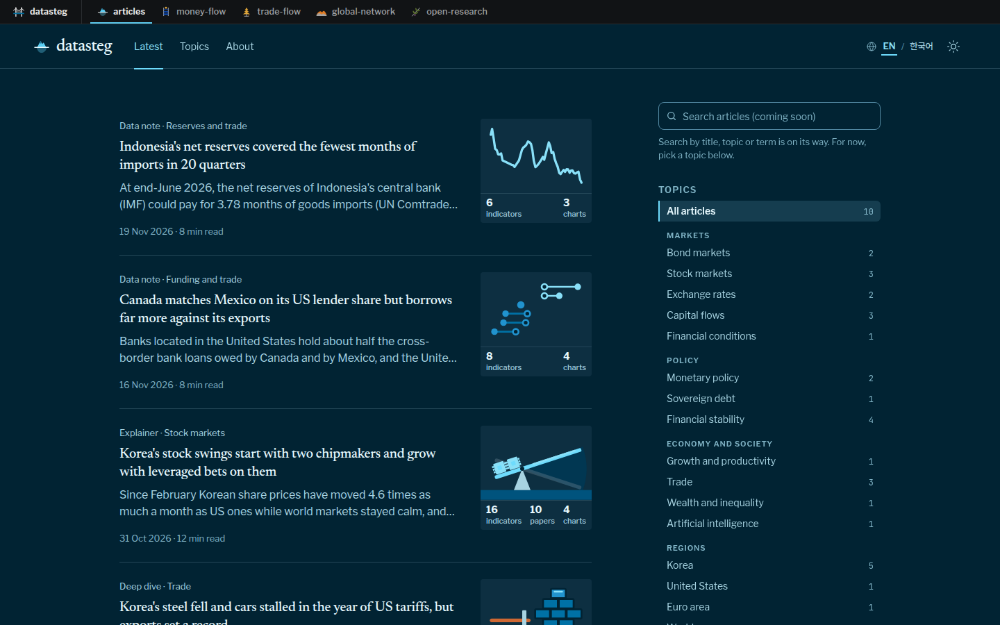
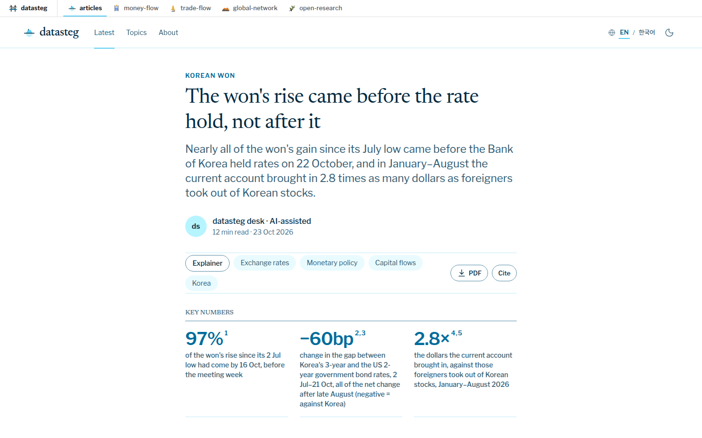
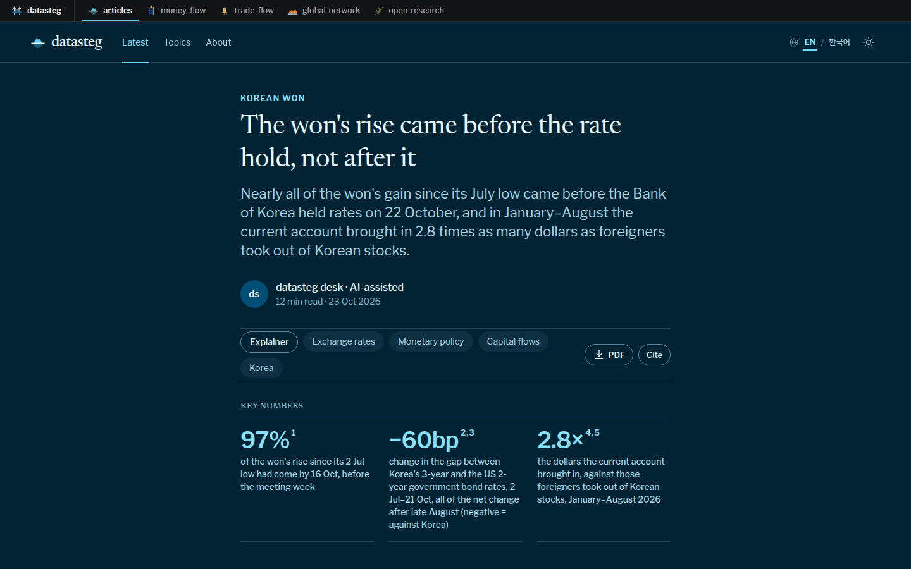

# datasteg articles

[articles.datasteg.com](https://articles.datasteg.com) publishes explainers on economics and finance, in English
and in Korean, each answering one reader's question with central-bank research and official statistics. Every
article is made by a newsroom of AI agents: they test the question, read the research, fetch and compute the data,
write both editions, draw the charts and review the result, while plain code runs the pipeline, computes and checks
every number and publishes. Each article shows its numbered facts, its chart data as CSV, its sources with quotes,
its glossary terms and how it was made. This repository holds the site, the pipeline, the agents' skills and
prompts, the contracts between them, and the articles as published.

| Light | Dark |
|---|---|
|  |  |
|  |  |

## From data to publication

An article run is a folder of JSON files. A driver in code (`artools drive`) follows the article type's pipeline
(`config/pipelines/<type>.yaml`) and starts each AI stage as its own headless Claude Code session that may write
only in the run's folder. After every stage, code validates the output against its schema in `contracts/`; a stage
that fails gets one more attempt with the problems listed, and a second failure stops the run. The diagrams of all
six article types are in [docs/PIPELINES.md](docs/PIPELINES.md).

The explainer, step by step (**agent**: a model does the work every time; **code**: plain code, no model;
**gate**: an approval):

| Phase | Step | Who | What happens |
|---|---|---|---|
| Question | Frame | agent | Writes the question as a brief: sub-questions, places, periods, the data it needs, every premise it takes for granted |
| | Scout | agents | The source skills, in a quick mode: a first search of the research archive, and the latest values and historical extremes of each quantity the question names |
| | Critical review | agent | Tests each premise against that first evidence, then refines, reframes or declines the question |
| | Question gate | gate | Approves the question before any deep research |
| Research | Read the research | agents | Searches the research archive (central-bank and institutional papers and speeches) and sends one paper-reader agent per chosen paper; every quote is checked word for word against the stored text |
| | Map mechanisms | agent | The mechanisms the literature proposes, and the indicators each needs |
| Data | Fetch data | agents + code | Find the series at FRED, the Bank of Korea (ECOS), the ECB and Eurostat; code validates each one (freshness, coverage, units, range, published anchor values, licence) |
| | Compute facts | agent + code | Every number the article will use becomes a fact with value, unit, period and sources, computed from unrounded inputs |
| Writing | Plan | agent | The answer in one sentence, the headline, three key numbers, the sections and a figure for each main point |
| | Plan gate | gate | Approves the plan |
| | Draft EN · KO | agent | Both editions from the same plan and facts; numbers only as fact tokens, every claim with a citation |
| | Charts | agent + code | Chart files in the chart contract; code renders them in both languages and themes and the agent inspects the images |
| Review | Review and fact-check | agents + code | A reviewer and an independent fact-checker (who did not write the text) read every sentence; code runs the mechanical checks; blocking issues go back to the stage that owns them |
| Publish | Cover | agent | A small drawing of the subject in the design system's palette |
| | PDF edition | agent + code | Code prints each edition as a journal page; the agent proofreads it page by page |
| | Publish gate | gate | Approves the article |
| | Publish | code | `artools ship`: writes `content/`, prints the PDFs, runs the site's content checks and build, commits, deploys and fetches the live pages |
| | Video | agents + code | A two-host audio overview of the article (NotebookLM), transcribed by an open-weights speech model, cut to slides drawn with the site's own components, reviewed by an agent and uploaded to YouTube in both languages |

The gates are configured in `config/editorial.yaml`. Today they are approved automatically by the driver, and the
editor reviews each article on the site after it goes live; corrections go through the `update-article` agent,
which reruns the stages that own a fix and republishes with a visible correction. Some failures always stop a run:
data whose licence does not allow publication, citations or source lines that fail the content checks, and a slug
that belongs to another run.

**The data note** (`config/pipelines/data-note.yaml`, `pipeline/artools/desk/`) is a shorter, daily format written
from datasteg's own data sites through their public API. Code watches the apps for new data and screens 36
economies for readings no single page shows; an editor agent picks one story and the rival explanations it must
face; code pulls the tables; an analyst agent writes each number as a formula that code computes; a writer agent
drafts with references to those facts only; three reviewers (an economist referee, a fact-checker, and a test of
what a skimming reader concludes) and a judge, who scores the note against short articles published by
institutions, decide whether it is good enough. The Korean edition is drafted string by string by datasteg's own
Korean language model and checked by code. A data note is published only after a person approves it.

The models are Claude (Opus, Sonnet and Fable) through Claude Code, and, for Korean wording and speech
transcription, open-weights models run on datasteg's own hardware. Every AI agent on datasteg, with what starts it,
what it may change and what approves its work, is listed at
[datasteg.com/en/technology/agents](https://www.datasteg.com/en/technology/agents).

## How the numbers are kept honest

- **No typed numbers.** Every number in reader-facing prose is a fact token (`{{F4}}`) pointing at a computed fact;
  the publisher renders it in each language from the same value, with each language's units. `artools check numbers`
  fails a draft with a typed digit. The same facts are published with each article and served by the API.
- **Both editions say the same thing.** The two editions are drafted from one plan and one fact list, so their
  numbers cannot differ; the fact-checker also checks that the Korean edition makes the same claims, and the site's
  build fails when the editions disagree on the key numbers or on the digits in their findings.
- **Quotes are verified.** A quote from a paper or speech is accepted only if it is found word for word in the
  document's stored text (`artools quote verify`).
- **Claims built from numbers are tested.** "The widest since 2012" or "for the first time" is checked against the
  data with read-only SQL over the run's datasets before it may stand.
- **Data must be publishable.** A FRED series is used only if its copyright tags allow it, an ECOS table only if the
  Bank of Korea produced it; a fact is publishable only if all its inputs are.
- **Charts agree with the data.** `artools check charts` compares a chart's values with the dataset it names; every
  chart ships with its table and CSV.
- **The build checks the content.** `scripts/check-content.mjs` runs on every build: approval, references, chart
  and PDF files, glossary links. `scripts/check-colors.mjs` keeps every colour a design token.
- **Korean interface text has one source.** Every Korean string of the site's interface comes from datasteg's Korean
  language model, and the deploy refuses a Korean string that did not.

The style and judgement rules the agents follow are in `guides/` (voice in each language, readability, numbers,
charts, citations, covers, and the templates of each article type), and in each skill's `SKILL.md`.

## Repository map

| Folder | What is in it |
|---|---|
| [`apps/web/`](apps/web) | The Next.js site: feed, article pages, glossary, topics, method pages, the PDF print layout, and the read-only `/svc/v1` views behind the datasteg API |
| [`apps/studio/`](apps/studio) | A local-only slide studio: the article's own components at 1920×1080 for the video |
| [`packages/`](packages) | The Glacier design system (`tokens`, `ui`, `fonts`), the article charts (`charts`) and the interface strings (`i18n`) |
| [`pipeline/artools/`](pipeline/artools) | `artools`, the newsroom's command line: the driver, run folders, validation, data fetch and SQL, checks, rendering, publishing, the video pipeline and the data desk |
| [`pipeline/tests/`](pipeline/tests) | Offline tests of the pipeline (no network, no model) |
| [`.claude/skills/`](.claude/skills) | The AI agents' skills: the stage skills (`frame-question` … `publish-article`, `update-article`), the source skills (`search-jejualps` for the research archive, `fetch-fred`, `fetch-ecos`, `fetch-public-data`), the video skills, and sample skills for the other article types |
| [`.claude/agents/`](.claude/agents) | Subagents: `paper-reader`, `fact-checker`, `video-checker` |
| [`guides/`](guides) | The style books and prompts: voice (English and Korean), readability, numbers, charts, citations, covers, video, the article templates, and the data desk's role briefs (`guides/desk/roles/`) and standard |
| [`contracts/`](contracts) | JSON Schemas for every run file, and `content.md`, the contract between the newsroom and the site |
| [`config/`](config) | The article types and their pipelines, the sources, topics, editorial limits and gates, the data desk, and the video settings |
| [`content/`](content) | The published articles (both editions, facts, charts and their CSVs, sources, covers, PDFs) and the glossary |
| [`scripts/`](scripts) | The site's build scripts: the content index and the content and colour checks |
| [`docs/PIPELINES.md`](docs/PIPELINES.md) | Every article type and its pipeline as a diagram, generated from `config/pipelines/` |

## Design

The site is drawn in **Glacier**: a snow-white reading surface by day and night ice by night, light-filled ice for
panels, one bright cyan for actions, a deep blue-black for text, and a warm alpenglow kept for the editor's voice.
Every colour, size and space is a token, in both themes. See [DESIGN.md](DESIGN.md).

## Links

- The site: [articles.datasteg.com](https://articles.datasteg.com)
- datasteg and its other sites: [www.datasteg.com](https://www.datasteg.com)
- How datasteg works: [datasteg.com/en/technology](https://www.datasteg.com/en/technology)
- The public API and MCP server, which serve these articles, their facts and chart data:
  [datasteg.com/en/technology/api](https://www.datasteg.com/en/technology/api)

## About this repository

This is a read-only snapshot of the code behind the live site, published to show how it works. It is not set up to
run on its own: the pipeline needs the research archive, API keys, datasteg's own models and services, and a
deployment that are not part of it. The articles in `content/` carry only what the site itself publishes, including
the chart data it offers for download; no source datasets are included, and datasteg does not redistribute source
data. For data, use the sites or the public API.

© datasteg. All rights reserved.
