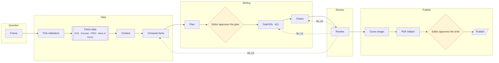
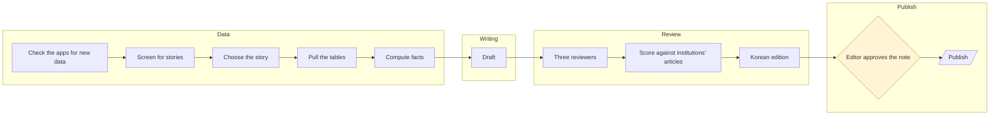
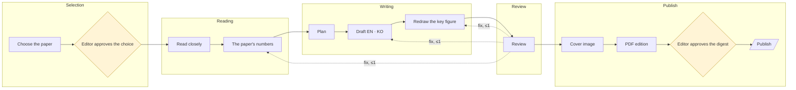
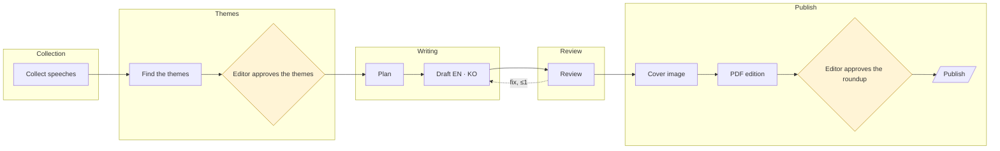

# Pipelines

Generated by `artools pipelines docs` from `config/pipelines/*.yaml`; edit the YAML, not this file.

| Type | Status | What it is | Length | Figures | Editor gates | Steps |
|---|---|---|---|---|---|---|
| `explainer` | live | One reader question, answered with research and data | 1,200–1,800 words | 3–6 | 3 | 18 |
| `data-brief` | sample | A number that moved, what it means, in three charts or fewer | 400–700 words | 1–3 | 2 | 14 |
| `data-note` | sample | One finding that only joined sources show, from datasteg's own data | 650–1,100 English words | 2–3 | 1 | 11 |
| `deep-dive` | sample | An explainer plus a model design: how one could measure and forecast it | 2,000–3,000 words + technical appendix | 5–8 | 4 | 19 |
| `paper-digest` | sample | One new paper: what it asks, what it finds, why it matters | 700–1,000 words | 1–2 | 2 | 12 |
| `speech-roundup` | sample | What central bankers said this month, theme by theme, in their own words | 900–1,400 words | 0–1 | 2 | 10 |

## Explainer (`explainer`, v1.3, live)

One reader question, answered with research and data.

```mermaid
flowchart LR
  subgraph ph_question["Question"]
    direction TB
    frame["Frame"]
    scout[["Scout<br/><small>Archive · Statistics</small>"]]
    refine["Critical review"]
    gate_question{"Editor approves the question"}
  end
  subgraph ph_research["Research"]
    direction TB
    search["Read the research"]
    map["Map mechanisms"]
  end
  subgraph ph_data["Data"]
    direction TB
    fetch[["Fetch data<br/><small>ECB · Eurostat · FRED · Bank of Korea</small>"]]
    analyze["Compute facts"]
  end
  subgraph ph_writing["Writing"]
    direction TB
    plan["Plan"]
    gate_plan{"Editor approves the plan"}
    draft["Draft EN · KO"]
    charts["Charts"]
  end
  subgraph ph_review["Review"]
    direction TB
    review["Review and fact-check"]
  end
  subgraph ph_publish["Publish"]
    direction TB
    cover["Cover image"]
    pdf["PDF edition"]
    gate_publish{"Editor approves the article"}
    publish[/"Publish"/]
    video["Video on YouTube"]
  end
  frame --> scout
  scout --> refine
  refine --> gate_question
  gate_question --> search
  search --> map
  map --> fetch
  fetch --> analyze
  analyze --> plan
  plan --> gate_plan
  gate_plan --> draft
  draft --> charts
  charts --> review
  review -. "fix, ≤2" .-> analyze
  review -. "fix, ≤2" .-> draft
  review -. "fix, ≤2" .-> charts
  review --> cover
  cover --> pdf
  pdf --> gate_publish
  gate_publish --> publish
  publish --> video
  classDef gate fill:#fff4d6,stroke:#b07d00
  class gate_question,gate_plan,gate_publish gate
```

## Data brief (`data-brief`, v0.3, sample)

A number that moved, what it means, in three charts or fewer.

Skills still in draft: `select-indicators`.

## Data note (`data-note`, v0.2, sample)

One finding that only joined sources show, from datasteg's own data.

## Deep dive (`deep-dive`, v0.3, sample)

An explainer plus a model design: how one could measure and forecast it.

```mermaid
flowchart LR
  subgraph ph_question["Question"]
    direction TB
    frame["Frame"]
    scout[["Scout<br/><small>Archive · Statistics</small>"]]
    refine["Critical review"]
    gate_question{"Editor approves the question"}
  end
  subgraph ph_research["Research"]
    direction TB
    search["Read the research"]
    map["Map mechanisms"]
  end
  subgraph ph_data["Data"]
    direction TB
    fetch[["Fetch data<br/><small>ECB · Eurostat · FRED · Bank of Korea</small>"]]
    analyze["Compute facts"]
  end
  subgraph ph_model["Model"]
    direction TB
    model["Design a model"]
    gate_model{"Editor approves the model design"}
  end
  subgraph ph_writing["Writing"]
    direction TB
    plan["Plan"]
    gate_plan{"Editor approves the plan"}
    draft["Draft EN · KO + appendix"]
    charts["Charts"]
  end
  subgraph ph_review["Review"]
    direction TB
    review["Review and methods check"]
  end
  subgraph ph_publish["Publish"]
    direction TB
    cover["Cover image"]
    pdf["PDF edition"]
    gate_publish{"Editor approves the article"}
    publish[/"Publish"/]
  end
  frame --> scout
  scout --> refine
  refine --> gate_question
  gate_question --> search
  search --> map
  map --> fetch
  fetch --> analyze
  analyze --> model
  model --> gate_model
  gate_model --> plan
  plan --> gate_plan
  gate_plan --> draft
  draft --> charts
  charts --> review
  review -. "fix, ≤3" .-> analyze
  review -. "fix, ≤3" .-> model
  review -. "fix, ≤3" .-> draft
  review -. "fix, ≤3" .-> charts
  review --> cover
  cover --> pdf
  pdf --> gate_publish
  gate_publish --> publish
  classDef gate fill:#fff4d6,stroke:#b07d00
  class gate_question,gate_model,gate_plan,gate_publish gate
```

Skills still in draft: `design-model`.

## Paper digest (`paper-digest`, v0.3, sample)

One new paper: what it asks, what it finds, why it matters.

Skills still in draft: `select-paper`, `read-paper`.

## Speech roundup (`speech-roundup`, v0.3, sample)

What central bankers said this month, theme by theme, in their own words.

Skills still in draft: `collect-speeches`, `cluster-themes`.
